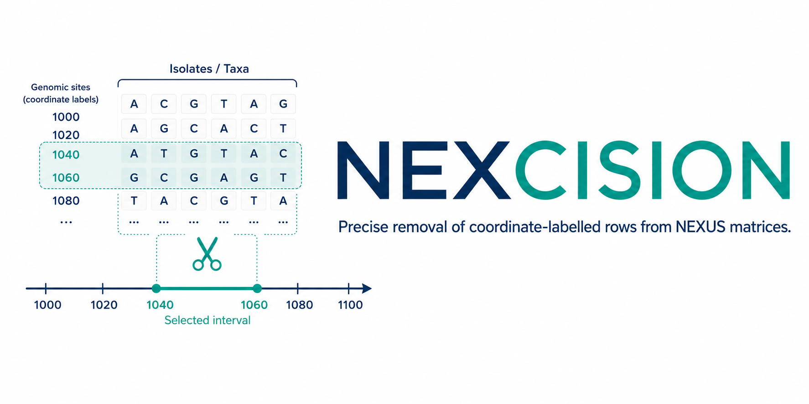

<p align="center">
  
</p>

<p align="center">
  
  
  
  
  
  
</p>

# NEXCISION benchmarking

This repository contains the **validation, benchmarking, analysis and manuscript materials** for [NEXCISION](https://github.com/RhysWhite/nexcision).

It is intentionally separate from the user-facing software repository. Users who only want to install and run NEXCISION do not need to download the experiments or manuscript analyses maintained here.

## Study design

| Experiment | Question | Status |
|---|---|---|
| [1. Formal correctness](experiments/experiment_1_correctness/) | Does NEXCISION remove exactly the intended rows and preserve everything else? | **Complete** |
| [2. Scalability](experiments/experiment_2_scalability/) | How do runtime and memory scale with matrix size and interval count? | **Complete** |
| [3. Independent equivalence](experiments/experiment_3_equivalence/) | Does NEXCISION reproduce independently derived masking results? | Planned |
| [4. Biological impact](experiments/experiment_4_biological_impact/) | How does masking affect SNP distances, clustering and phylogenetic interpretation? | Planned |

## Experiment 1 headline results

- **1,000/1,000** deterministic synthetic matrices passed.
- **304,000** coordinate-labelled site rows were evaluated.
- **113,740** rows were correctly removed and **190,260** were correctly retained.
- **3** genuine SPANDx matrices passed compatibility checks.
- **26/26** malformed-input and output-safety cases passed.
- **9/9** property-based invariants passed across **1,800** generated examples.
- **12/12** deliberately introduced implementation faults were detected.

The consolidated methods and results are in the [Experiment 1 report](experiments/experiment_1_correctness/validation/EXPERIMENT1_REPORT.md).

## Experiment 2 headline results

- **105/105** formal measured executions were correct.
- **21/21** configurations produced deterministic filtered outputs.
- Runtime scaled near-linearly with input size (**R² = 0.9986**).
- A **4.83 GiB** matrix was processed in **24.24 s** on one pinned logical CPU of an AMD EPYC 9374F node.
- Peak memory scaled at approximately **4.85 GiB RSS per GiB of input**.
- Increasing the exclusion list from **1 to 100,000 intervals** increased median runtime by only **13.5%**.
- Disjoint, adjacent, overlapping and nested interval sets differed in median runtime by only **2.8%**.

The formal design is documented in the [Experiment 2 protocol](experiments/experiment_2_scalability/FORMAL_BENCHMARK_PROTOCOL.md), and the manuscript-ready interpretation is in the [Experiment 2 Results section](manuscript/results/EXPERIMENT2_RESULTS.md).

## Repository structure

```text
nexcision-benchmarking/
├── software/                         # exact NEXCISION wheel evaluated
├── environments/                     # reproducible Python dependencies
├── experiments/
│   ├── experiment_1_correctness/     # completed formal validation
│   ├── experiment_2_scalability/     # runtime and memory benchmarks
│   ├── experiment_3_equivalence/     # independent-method comparison
│   └── experiment_4_biological_impact/
├── data/                             # data-access notes; large/private inputs excluded
├── manuscript/
│   ├── figure_legends/
│   ├── figures/
│   ├── results/
│   ├── tables/
│   └── supplementary/
├── assets/                           # README graphics
└── scripts/                          # top-level reproduction helpers
```

Generated matrices, filtered benchmark outputs, repeated logs and temporary files are excluded from Git history. Compact measured-result tables, system metadata and derived summaries are retained so manuscript claims remain auditable.

## Quick start: reproduce the lightweight Experiment 1 suite

Clone this repository and run:

```bash
git clone https://github.com/RhysWhite/nexcision-benchmarking.git
cd nexcision-benchmarking

python -m venv .venv
source .venv/bin/activate
python -m pip install --upgrade pip
python -m pip install -r environments/experiment1-requirements.txt
python -m pip install software/nexcision-0.1.0-py3-none-any.whl

python scripts/run_experiment1_light.py
```

On Windows PowerShell, activate the environment with:

```powershell
.venv\Scripts\Activate.ps1
```

The full 1,000-case corpus is regenerated and tested with:

```bash
python scripts/run_experiment1_full.py
```

A dependency-free repository-integrity audit is available with:

```bash
python scripts/verify_repository.py
```

## Software evaluated

Experiment 1 evaluated the exact wheel stored at:

```text
software/nexcision-0.1.0-py3-none-any.whl
```

SHA-256:

```text
f980aa7e1f4b5ef67ebe10b4117a07af3405ee0cd3805c1d2d9e936a284689d4
```

The wheel is stored here because it is small and ensures that the experimental record remains tied to the exact software artifact evaluated. Ongoing NEXCISION development remains in the [main software repository](https://github.com/RhysWhite/nexcision).

## Data policy

The three genuine SPANDx matrices used during Experiment 1 are **not committed** to this repository. Their filenames, characteristics and SHA-256 checksums are recorded in [`data/real_inputs/README.md`](data/real_inputs/README.md). Synthetic matrices are generated locally and excluded from version control.

## Manuscript outputs

Publication figures, tables and supplementary material are generated from version-controlled analysis scripts and stored under [`manuscript/`](manuscript/). Compact source measurements remain under the relevant experiment directory, separate from polished manuscript products.

## Funding and affiliation

<p align="center">
  <a href="https://www.genomics-aotearoa.org.nz/">
    
  </a>
  &nbsp;&nbsp;&nbsp;&nbsp;&nbsp;&nbsp;
  <a href="https://www.phfscience.nz/">
    
  </a>
</p>

<p align="center">
  Development of NEXCISION was supported by
  <strong>Genomics Aotearoa</strong> and undertaken at
  <strong>Public Health and Forensic Science (PHF Science),
  Aotearoa New Zealand</strong>.
</p>

## Citation

Citation metadata are provided in [`CITATION.cff`](CITATION.cff). Until a formal software paper or DOI is available, cite the relevant tagged releases of both the NEXCISION software and this benchmarking repository.

## License

The code and documentation in this repository are available under the [MIT License](LICENSE). Third-party datasets and institutional branding may be subject to separate terms.
